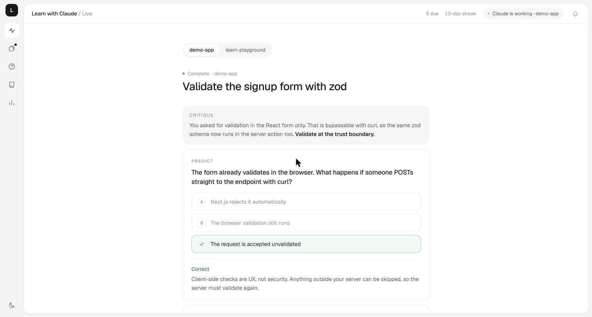
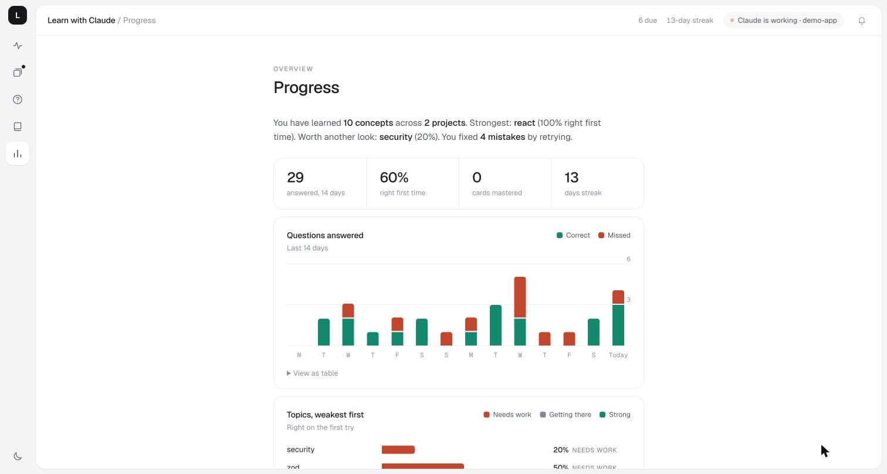
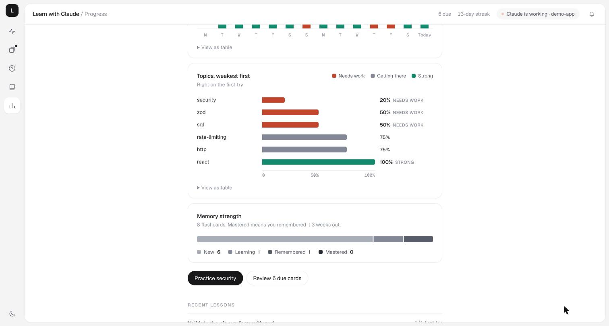
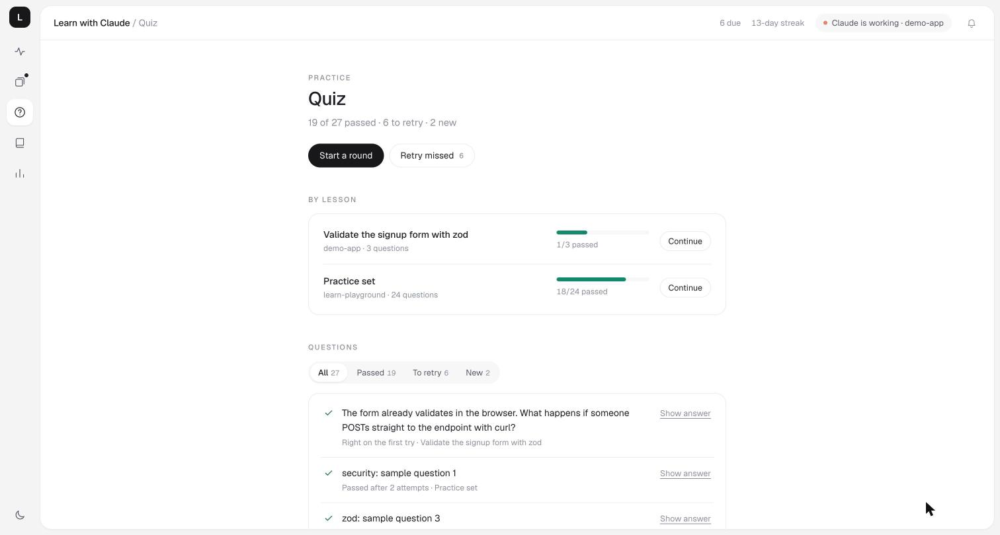

# Learn with Claude

**Learn what Claude changes, while it changes it.**

A plugin for [Claude Code](https://claude.com/claude-code) that turns the time you spend waiting on an agent into active learning. The agent critiques your request, builds in the background, and streams a short lesson about the change into a live dashboard: predict-first questions, concept notes grounded in your own code, a walkthrough of the diff, and flashcards that come back just before you would forget them.



---

## Contents

- [The problem](#the-problem)
- [How it works](#how-it-works)
- [An example session](#an-example-session)
- [Install](#install)
- [Usage](#usage)
- [The dashboard](#the-dashboard)
- [Modes](#modes)
- [How it is built](#how-it-is-built)
- [Privacy](#privacy)
- [Configuration](#configuration)
- [Development](#development)
- [License](#license)

---

## The problem

Coding agents made writing code fast. They also made it easy to stop understanding it.

The usual loop is passive: you type a prompt, wait, skim a diff, and accept it. A week later you can't explain why the code looks the way it does, and you can't spot the same problem the next time. Three things get lost:

| What gets lost | Why it matters |
|---|---|
| **The why** | You get the code but not the reasoning behind it, so you can't judge the next change. |
| **The pushback** | Agents do what you ask, even when a better approach exists. Nobody tells you that client-side validation can be bypassed. |
| **The memory** | Reading an explanation once feels like learning, but without retrieval and spacing it fades within days. |

Learn with Claude keeps the speed and puts the learning back, using techniques with strong evidence behind them:

- **Prediction before explanation** (the generation effect): you guess before you are told, so the answer sticks.
- **Retrieval practice:** short multiple-choice questions with instant feedback, graded by the plugin, not by the model.
- **Spaced repetition:** flashcards scheduled with an SM-2-style algorithm, so each card returns right before you would forget it.
- **Learning from mistakes:** every missed question becomes a flashcard automatically.

## How it works

Decisions stay in the chat. Learning goes to the dashboard. The session is never blocked waiting for a quiz answer.

```
you ──► request
          │
          ▼
   1. Critique        in the chat: a better approach and its tradeoff, if there is one. You choose.
          │
          ├──────────────────────────────┐
          ▼                              ▼
   2. Builder agent               3. Teacher agent
      writes and verifies            streams the lesson into the dashboard:
      the code (background)          predict questions, concept notes from your code
          │                              │
          ▼                              ▼
   4. Walkthrough                 what changed and why, questions on the real diff, flashcards
          │
          ▼
   5. Recap                       three lines in the chat: score, what you missed, the one idea to remember
```

While you answer questions in the dashboard, a hook reports your results back to the session. If you missed something, Claude clears it up in one sentence in its next reply.

Teaching scales with the task. Trivial chores get none, small changes get one question, real features get the full flow. "Just do it" always skips it.

## An example session

You ask for something reasonable but flawed:

```
> add email validation to signup, just do it in the frontend form
```

Claude pushes back before writing any code:

```
Critique: validation that only runs in the browser can be bypassed with curl.
The trust boundary is the server. I recommend one shared schema, used by the
form for instant feedback and by the signup endpoint for safety.

  [ Shared schema (recommended) ]   [ Frontend only ]
```

You pick the shared schema. Claude starts the builder and the teacher in the background and tells you where to look:

```
Lesson is live in the dashboard (http://127.0.0.1:4477). I'll let you know when the build is done.
```

While the code is being written, the dashboard asks you to predict first:

```
PREDICT
The form already validates in the browser. What happens if someone POSTs
straight to the endpoint with curl?

  A  Next.js rejects it automatically
  B  The browser validation still runs
  C  The request is accepted unvalidated
```

You answer, get instant feedback, and the concept note that was locked behind the prediction opens: *Validate at the trust boundary*, with a snippet from your own code.

When the build finishes, the walkthrough appears (`lib/schemas.ts:4`, `app/signup/actions.ts:12`, each with the reason it was done that way), followed by a question about the actual diff. Back in the chat you get a short recap:

```
Lesson: Validate signup · 2/3 correct · 3 cards saved · 1 question still open
Missed: curl bypass → the request is accepted unvalidated. Client checks are UX, not security.
Remember: validate at the trust boundary.
```

Tomorrow, the flashcards come back for review.

Want to try this end to end? Use a small project with real problems to fix, such as an API that stores passwords in plain text, and ask Claude to fix them one at a time.

## Install

Requires Node.js 18 or later. There is nothing to `npm install`: the plugin has no dependencies.

```
/plugin marketplace add babakhalid/learn-with-claude
/plugin install learn-with-claude@learn-with-claude
```

Restart Claude Code. Teach mode is on (`sidecar`) by default.

## Usage

Ask for changes as usual. Teach mode starts on its own for anything worth learning from.

| Command | What it does |
|---|---|
| just ask for a change | teach mode starts automatically |
| `/learn-with-claude:teach <task>` | force teach mode for one task |
| `/learn-with-claude:review [topic]` | a two-minute spaced-repetition review in the chat |
| `/learn-with-claude:progress` | stats, and opens the dashboard |
| `/learn-with-claude:mode <mode>` | change the mode (see [Modes](#modes)) |

You can also run the dashboard on its own:

```
node mcp/cli.js dashboard
```

## The dashboard

A local web page at `http://127.0.0.1:4477`. It opens once per session and updates by itself.

| Section | What it shows |
|---|---|
| **Live** | The lesson for the task in progress: the critique, predict questions, concept notes (locked until you predict), the walkthrough of the diff, and the result. With several projects building at once, a switcher appears. |
| **Review** | Due flashcards. Type your answer first, reveal, then grade with keys 1 to 4. |
| **Quiz** | Every question you have seen, filtered by passed, to retry, or new. Redo a lesson's quiz, retry only what you missed, or reveal the answer of a question you already passed. |
| **Lessons** | Every task you built in teach mode, with its critique and changes. |
| **Progress** | A personal summary, questions answered over 14 days, topics from weakest to strongest, and memory strength of your flashcards. |







The header shows what each coding session is doing: working, finished, or waiting for you, with the question it asked. A notification appears when that changes, and a browser notification if the tab is in the background. The dashboard follows your system's light or dark theme, and the toggle at the bottom of the side rail overrides it.

## Modes

| Mode | In the chat | In the dashboard |
|---|---|---|
| `sidecar` (default) | the critique and a recap of three lines or fewer | the full lesson, live |
| `inline` | the full lesson: questions asked in the chat | history and practice |
| `light` | one line pointing to the dashboard | one note, one question, one or two flashcards |
| `off` | nothing | your existing cards and quizzes stay available |

## How it is built

```
.claude-plugin/          Claude Code manifest and marketplace
skills/teach/            the teaching protocol: calibrate, critique, then sidecar, inline or light
skills/review/           spaced-repetition review in the chat
skills/progress/         stats and dashboard
agents/builder.md        writes and verifies the code, always in the background
agents/teacher.md        writes the lesson into the dashboard (Sonnet, read-only)
commands/mode.md         /learn-with-claude:mode
hooks/                   session start, prompt reminders, and live status (Stop, Notification, AskUserQuestion, SessionEnd)
mcp/server.js            the "learn" MCP server: lessons, quizzes graded server-side, flashcards, scheduling
mcp/store.js             storage and the SM-2-style scheduler
mcp/dashboard.*          the local web dashboard
```

A few design choices worth knowing:

- **Grading happens in the MCP server**, not in the model, so a wrong answer can't be marked right. The answer to a question is never sent to the page until you have answered it correctly.
- **The teacher is read-only.** It can't edit files, so it never collides with the builder.
- **Each dashboard server reads its page once at startup,** and a newer session never reuses a dashboard started by older code. The page and its API always match.

## Privacy

Everything stays on your machine.

- Your lessons, cards, and answers are stored in `~/.learnwithclaude/deck.json`.
- The dashboard listens on `127.0.0.1` only, and rejects writes (answers, grades) coming from other websites.
- The plugin itself makes no network calls. The only model calls are the ones your coding agent already makes.

## Configuration

| Variable | Default | Purpose |
|---|---|---|
| `LEARN_HOME` | `~/.learnwithclaude` | where lessons, cards, and settings are stored |
| `LEARN_PORT` | `4477` | first port the dashboard tries; it moves up if the port is taken |

To use a different model for the teacher, change `model:` in `agents/teacher.md`.

## Development

```
git clone https://github.com/babakhalid/learn-with-claude.git
cd learn-with-claude
npm test                  # store, scheduler, MCP protocol, dashboard API, hooks, sessions
npm run demo              # a dashboard with sample data and a lesson streaming in
claude --plugin-dir .     # try the plugin without installing it
claude plugin validate .
```

When you add or remove a hook in `hooks/hooks.json`, bump `HOOKS_VERSION` in `hooks/context.js` and the `--hooks=N` tag on every hook command. Claude Code reads the hook list once per session, and the tag stops sessions started with an older list from reporting a status they can't finish.

Issues and pull requests are welcome.

## License

[MIT](LICENSE). The dashboard bundles the [Geist](https://github.com/vercel/geist-font) and Geist Mono typefaces under the [SIL Open Font License 1.1](mcp/fonts/OFL.txt).
